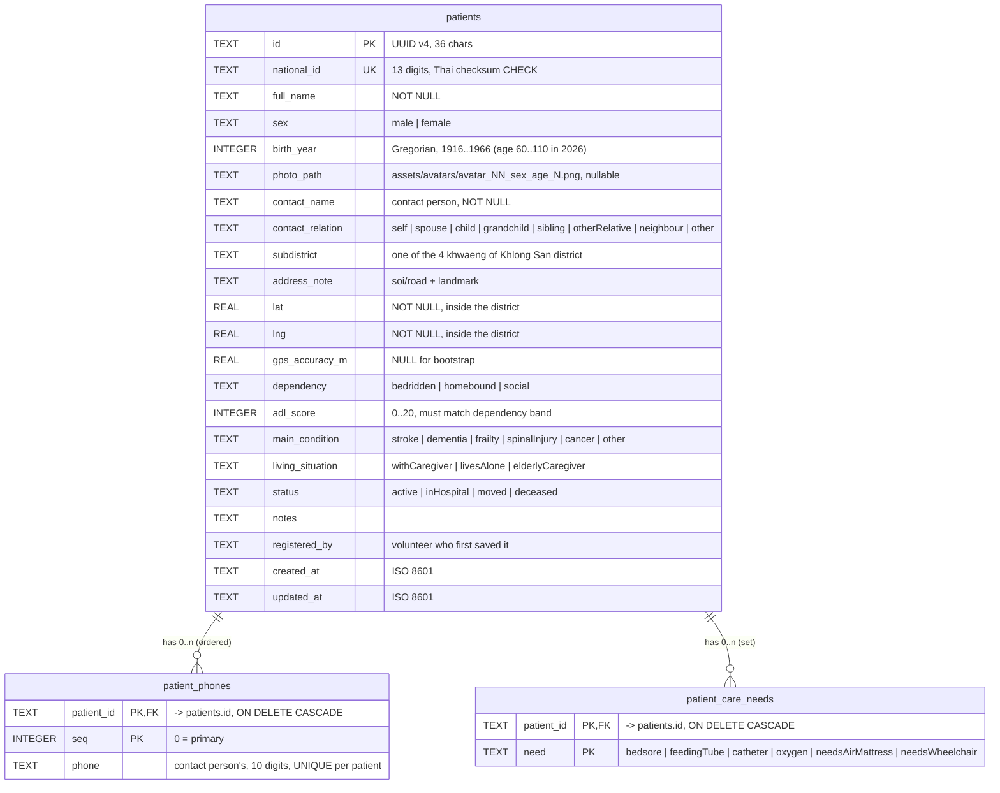

# ER diagram — sample-data SQLite schema

Source of truth is [`schema.sql`](schema.sql) (generated by
[`gen_bootstrap.dart`](gen_bootstrap.dart)). Update this diagram when the
schema changes.

Notes
- Enums are `TEXT` with `CHECK (... IN (...))`; SQLite has no enum type.
- Foreign keys only work when `PRAGMA foreign_keys = ON` is set on the connection (sqflite: in `onConfigure`).
- `patient_care_needs.need` has its own index for "everyone who needs X" queries.
