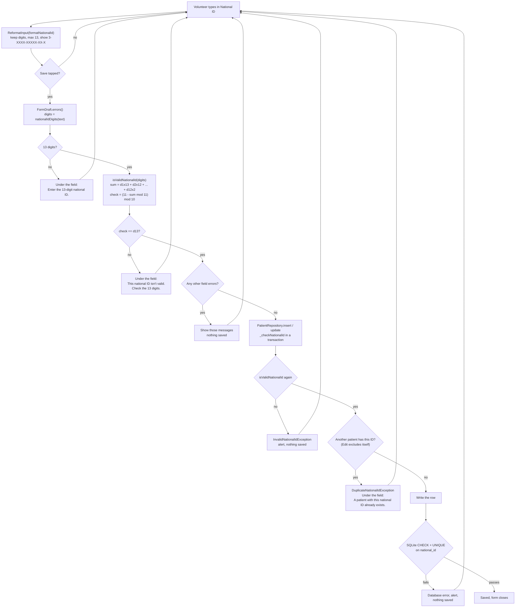

# National ID validation

How a Thai national ID is checked from the moment a volunteer types it on the
Add / Edit form until the patient is saved (SPEC §5, §6 Startup 4, §7.3).
There are three layers. The form gives messages, the repository enforces the
rule on every save, and the SQLite schema is the last guard.

## The checksum

For the digits d1 … d13:

- sum = d1×13 + d2×12 + … + d12×2 (SPEC §5 writes the weight as 14 − i for
  i = 1…12)
- check digit = (11 − sum mod 11) mod 10, which must equal d13

Example, the ID in Figma frame 19, `3-1015-18743-45-9`:

| Digit | 3 | 1 | 0 | 1 | 5 | 1 | 8 | 7 | 4 | 3 | 4 | 5 |
|---|---|---|---|---|---|---|---|---|---|---|---|---|
| Weight | 13 | 12 | 11 | 10 | 9 | 8 | 7 | 6 | 5 | 4 | 3 | 2 |
| Product | 39 | 12 | 0 | 10 | 45 | 8 | 56 | 42 | 20 | 12 | 12 | 10 |

The sum is 266, and 266 mod 11 = 2. (11 − 2) mod 10 = **9**, which matches
the last digit, so the ID is valid.

## Where each step lives

| Step | Code |
|---|---|
| Typing: digits only, at most 13, shown as `3-XXXX-XXXXX-XX-X` | `formatNationalId`, `nationalIdDigits` in `lib/shared/national_id.dart`; `ReformatInput` in `lib/features/form/form_widgets.dart` |
| Length and checksum messages after Save, live after that | `FormDraft.errors()` in `lib/features/form/form_draft.dart` |
| The checksum itself | `isValidNationalId` in `lib/shared/national_id.dart` |
| Checksum again, then the duplicate lookup, before any write | `PatientRepository._checkNationalId` in `lib/data/patient_repository.dart` |
| The duplicate message under the field; it clears when the ID changes | `_PatientFormScreenState._save` / `_errors` in `lib/features/form/patient_form_screen.dart` |
| Last guard: 13 digits, the same checksum in SQL, `UNIQUE` | `national_id` column in `data/schema.sql` |

The messages come from constants, so the form and the repository can't drift:
`invalidNationalIdMessage` and `DuplicateNationalIdException.message`.

## Known limits

- Only the checksum is checked. Real Thai IDs start with a digit from 1 to 8,
  so an ID starting with 0 or 9 passes if its checksum is right. SPEC §5 asks
  for no more.
- The duplicate check is an exact match on the 13 stored digits.
- Tests: `test/shared/shared_test.dart` (the checksum and formatting),
  `test/data/patient_repository_test.dart` (the exceptions) and
  `test/features/form/validation_test.dart` (the messages on the form).
